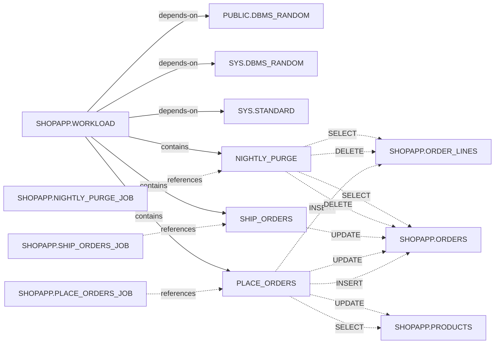

# PL/SQL: SHOPAPP.WORKLOAD

Summary: 3 subprograms, 3 tables written, 3 jobs; status: VALID.

Target: p1-19c-prod. Complete dictionary evidence.

## Overview

- PACKAGE: VALID; last DDL 2026-10-25T05:41:39.000Z
- PACKAGE BODY: VALID; last DDL 2026-10-25T05:41:39.000Z

## Evidence

- objects: ok; DBA_OBJECTS
- source: ok; DBA_SOURCE
- procedures: ok; DBA_PROCEDURES
- arguments: ok; DBA_ARGUMENTS
- dependencies: ok; DBA_DEPENDENCIES
- callers: ok; DBA_DEPENDENCIES
- errors: ok; DBA_ERRORS
- jobs: ok; DBA_SCHEDULER_JOBS

## Compile errors

None returned.

## Subprograms

### PLACE_ORDERS(P_COUNT IN BINARY_INTEGER DEFAULT 25)

```plsql
PROCEDURE place_orders(p_count PLS_INTEGER DEFAULT 25);
```

Body range (heuristic): PACKAGE BODY lines 2–18.

Table operations (heuristic):

- SHOPAPP.ORDERS: INSERT, UPDATE
- SHOPAPP.ORDER_LINES: INSERT
- SHOPAPP.PRODUCTS: SELECT, UPDATE

### SHIP_ORDERS()

```plsql
PROCEDURE ship_orders;
```

Body range (heuristic): PACKAGE BODY lines 19–23.

Table operations (heuristic):

- SHOPAPP.ORDERS: UPDATE

### NIGHTLY_PURGE()

```plsql
PROCEDURE nightly_purge;
```

Body range (heuristic): PACKAGE BODY lines 24–29.

Table operations (heuristic):

- SHOPAPP.ORDERS: SELECT, DELETE
- SHOPAPP.ORDER_LINES: SELECT, DELETE

## Tables used (package/object union; heuristic static scan)

Dictionary table dependencies; operations are lexical hints, not runtime proof. Dynamic SQL, synonyms and quoted identifiers may be missed.

- SHOPAPP.ORDERS: SELECT, INSERT, UPDATE, DELETE
- SHOPAPP.ORDER_LINES: SELECT, INSERT, DELETE
- SHOPAPP.PRODUCTS: SELECT, UPDATE

## Callers

None returned.

## Scheduler jobs (text references, heuristic)

- SHOPAPP.NIGHTLY_PURGE_JOB: SCHEDULED; BEGIN shopapp.workload.nightly_purge; END;
- SHOPAPP.PLACE_ORDERS_JOB: SCHEDULED; BEGIN shopapp.workload.place_orders(25); END;
- SHOPAPP.SHIP_ORDERS_JOB: SCHEDULED; BEGIN shopapp.workload.ship_orders; END;

## Dependency diagram

Operation edges use bounded subprogram scans (heuristic); unresolved ranges and non-table dependencies fall back to the object. Job entry points are lexical references, not runtime proof.



## Source appendix (redacted; maximum 2,000 lines across spec and body)

PACKAGE 1: PACKAGE         workload AS  
PACKAGE 2:   PROCEDURE place_orders(p_count PLS_INTEGER DEFAULT 25);  
PACKAGE 3:   PROCEDURE ship_orders;  
PACKAGE 4:   PROCEDURE nightly_purge;  
PACKAGE 5: END workload;  
PACKAGE BODY 1: PACKAGE BODY         workload AS  
PACKAGE BODY 2:   PROCEDURE place_orders(p_count PLS_INTEGER DEFAULT 25) IS  
PACKAGE BODY 3:     v_order NUMBER; v_total NUMBER := 0; v_price NUMBER; v_prod NUMBER; v_qty NUMBER;  
PACKAGE BODY 4:   BEGIN  
PACKAGE BODY 5:     FOR i IN 1 .. p_count LOOP  
PACKAGE BODY 6:       INSERT INTO orders (customer_id) VALUES (TRUNC(DBMS_RANDOM.VALUE(1, 50001))) RETURNING order_id INTO v_order;  
PACKAGE BODY 7:       v_total := 0;  
PACKAGE BODY 8:       FOR l IN 1 .. TRUNC(DBMS_RANDOM.VALUE(1, 6)) LOOP  
PACKAGE BODY 9:         v_prod := TRUNC(DBMS_RANDOM.VALUE(1, 5001)); v_qty := TRUNC(DBMS_RANDOM.VALUE(1, 4));  
PACKAGE BODY 10:         SELECT price INTO v_price FROM products WHERE product_id = v_prod;  
PACKAGE BODY 11:         UPDATE products SET stock = stock - v_qty WHERE product_id = v_prod;  
PACKAGE BODY 12:         INSERT INTO order_lines VALUES (v_order, l, v_prod, v_qty, v_qty * v_price);  
PACKAGE BODY 13:         v_total := v_total + v_qty * v_price;  
PACKAGE BODY 14:       END LOOP;  
PACKAGE BODY 15:       UPDATE orders SET total = v_total WHERE order_id = v_order;  
PACKAGE BODY 16:       COMMIT;  
PACKAGE BODY 17:     END LOOP;  
PACKAGE BODY 18:   END;  
PACKAGE BODY 19:   PROCEDURE ship_orders IS  
PACKAGE BODY 20:   BEGIN  
PACKAGE BODY 21:     UPDATE orders SET status = '[REDACTED]' WHERE status = '[REDACTED]' AND ordered_at &lt; SYSTIMESTAMP - INTERVAL '[REDACTED]' MINUTE;  
PACKAGE BODY 22:     COMMIT;  
PACKAGE BODY 23:   END;  
PACKAGE BODY 24:   PROCEDURE nightly_purge IS  
PACKAGE BODY 25:   BEGIN  
PACKAGE BODY 26:     DELETE FROM order_lines WHERE order_id IN (SELECT order_id FROM orders WHERE ordered_at &lt; SYSTIMESTAMP - INTERVAL '[REDACTED]' DAY);  
PACKAGE BODY 27:     DELETE FROM orders WHERE ordered_at &lt; SYSTIMESTAMP - INTERVAL '[REDACTED]' DAY;  
PACKAGE BODY 28:     COMMIT;  
PACKAGE BODY 29:   END;  
PACKAGE BODY 30: END workload;  

