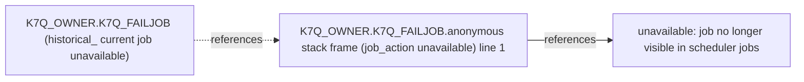

# Issue triage: d1-19c-lab

Read-only evidence. Hypotheses are ranked diagnostic leads, not proof. Credential-looking literals are redacted; ordinary business literals are preserved; graph call associations and statement ranges are heuristic.

## Issue 1

K7Q_FAILJOB on the lab keeps failing, what is wrong?

Window: 24h. Codes: ORA-20001, ORA-06512. Reported times: none.

### Ranked hypotheses

1. ORA-20001 at anonymous line 1 indicates RAISE_APPLICATION_ERROR in the job’s own PLSQL_BLOCK.

- K7Q_OWNER.K7Q_FAILJOB: scheduler history reports ORA-20001 and ORA-06512 at line 1.
- This is the anonymous job-block interpretation of the recorded stack; the dropped job_action is unavailable, so the exact call and guard cannot be inspected.
- K7Q_FAILJOB (all visible owners): outside the requested window (last run 2026-10-26T06:12:12.333Z); using up to 5 most recent runs as historical evidence. Requested window: 24h.

### Limitations

K7Q_FAILJOB (all visible owners): outside the requested window (last run 2026-10-26T06:12:12.333Z); using up to 5 most recent runs as historical evidence. Requested window: 24h.

K7Q_OWNER.K7Q_FAILJOB has run history but no row in DBA_SCHEDULER_JOBS: the job was dropped or auto-dropped, or is no longer visible. The exact job type/action, raising condition, source text and historical dependencies cannot be verified.

### Concurrency review

No supported concurrent child-insert path identified from the available source and job evidence.

### Suggested fixes (not executed)

Suggestions for a developer; no changes were run.

Inspect the unavailable source and raising condition before choosing a remediation; preserve exception/backtrace logging without credentials.

### Frame excerpts

K7Q_OWNER.K7Q_FAILJOB line 1 inside anonymous stack frame (job_action unavailable); unavailable; DBA_SCHEDULER_JOBS.

Statement (heuristic): `unavailable: job no longer visible in scheduler jobs`

Source unavailable; historical job_action and raising condition cannot be inspected.

### Evidence

Named scheduler job actions: ok; DBA_SCHEDULER_JOBS

No rows returned; absence is limited to visible evidence.

Scheduler run history in window: ok; DBA_SCHEDULER_JOB_RUN_DETAILS

No rows returned; absence is limited to visible evidence.

Latest scheduler runs for K7Q_FAILJOB (all visible owners): outside the requested window (last run 2026-10-26T06:12:12.333Z); max 5: ok; DBA_SCHEDULER_JOB_RUN_DETAILS; row cap reached (partial)

| OWNER | JOB_NAME | STATUS | ERROR# | ACTUAL_START_DATE | ADDITIONAL_INFO | OUTSIDE_WINDOW |
| --- | --- | --- | --- | --- | --- | --- |
| K7Q_OWNER | K7Q_FAILJOB | FAILED | 20001 | 2026-10-26T06:12:12.333Z | ORA-20001: destination unavailable<br>ORA-06512: at line 1<br> | 1 |
| K7Q_OWNER | K7Q_FAILJOB | FAILED | 20001 | 2026-10-26T06:10:49.661Z | ORA-20001: destination unavailable<br>ORA-06512: at line 1<br> | 1 |
| K7Q_OWNER | K7Q_FAILJOB | FAILED | 20001 | 2026-10-26T05:10:37.073Z | ORA-20001: destination unavailable<br>ORA-06512: at line 1<br> | 1 |
| K7Q_OWNER | K7Q_FAILJOB | FAILED | 20001 | 2026-10-26T02:45:06.008Z | ORA-20001: destination unavailable<br>ORA-06512: at line 1<br> | 1 |
| K7Q_OWNER | K7Q_FAILJOB | FAILED | 20001 | 2026-10-23T09:58:19.813Z | ORA-20001: destination unavailable<br>ORA-06512: at line 1<br> | 1 |

Compile errors in K7Q_OWNER: ok; DBA_ERRORS

No rows returned; absence is limited to visible evidence.

Invalid objects in K7Q_OWNER: ok; DBA_OBJECTS

No rows returned; absence is limited to visible evidence.

Candidate log tables in K7Q_OWNER (listed only): ok; DBA_TABLES

No rows returned; absence is limited to visible evidence.

### Local error guide

ORA-20001: Application-defined error. Typical causes: RAISE_APPLICATION_ERROR in stored source or scheduler anonymous job_action. Read-only checks: Inspect the raising statement and its guard; the message is application evidence.

### Numbered debug checklist

1. Named scheduler job actions. Look for the job type and entry point; an empty current dictionary result with retained history can mean a dropped or auto-dropped job.

```sql
SELECT OWNER, JOB_NAME, JOB_TYPE, JOB_ACTION FROM DBA_SCHEDULER_JOBS WHERE (JOB_NAME = 'K7Q_FAILJOB') ORDER BY OWNER, JOB_NAME
```

2. Scheduler run history in window. Look for FAILED runs, their exact error stack and start time; compare repeated failures with the reported incident window.

```sql
SELECT OWNER, JOB_NAME, STATUS, ERROR#, ACTUAL_START_DATE, ADDITIONAL_INFO FROM DBA_SCHEDULER_JOB_RUN_DETAILS WHERE ACTUAL_START_DATE >= SYSTIMESTAMP - NUMTODSINTERVAL(24, 'HOUR') AND (JOB_NAME = 'K7Q_FAILJOB') ORDER BY ACTUAL_START_DATE DESC NULLS LAST, LOG_ID DESC
```

3. Latest scheduler runs for K7Q_FAILJOB (all visible owners): outside the requested window (last run 2026-10-26T06:12:12.333Z); max 5. These are the latest retained runs without a time filter, capped at 5; check OUTSIDE_WINDOW and the last-run timestamp before treating an old failure as current.

```sql
SELECT OWNER, JOB_NAME, STATUS, ERROR#, ACTUAL_START_DATE, ADDITIONAL_INFO, CASE WHEN ACTUAL_START_DATE < SYSTIMESTAMP - NUMTODSINTERVAL(24, 'HOUR') THEN 1 ELSE 0 END AS OUTSIDE_WINDOW FROM DBA_SCHEDULER_JOB_RUN_DETAILS WHERE JOB_NAME = 'K7Q_FAILJOB' ORDER BY ACTUAL_START_DATE DESC NULLS LAST, LOG_ID DESC
```

4. Compile errors in K7Q_OWNER. Look for compiler line/position and messages naming the failing object or its dependencies.

```sql
SELECT OWNER, NAME, TYPE, LINE, POSITION, TEXT FROM DBA_ERRORS WHERE OWNER = 'K7Q_OWNER' ORDER BY NAME, TYPE, SEQUENCE
```

5. Invalid objects in K7Q_OWNER. Look for INVALID status on the failing unit or a dependency and compare LAST_DDL_TIME with the incident.

```sql
SELECT OWNER, OBJECT_NAME, OBJECT_TYPE, STATUS, LAST_DDL_TIME FROM DBA_OBJECTS WHERE OWNER = 'K7Q_OWNER' AND STATUS = 'INVALID' ORDER BY OBJECT_NAME, OBJECT_TYPE
```

6. Candidate log tables in K7Q_OWNER (listed only). Look for plausible application log names; only explicitly configured log tables may be read.

```sql
SELECT OWNER, TABLE_NAME FROM DBA_TABLES WHERE OWNER = 'K7Q_OWNER' AND (TABLE_NAME LIKE '%LOG%' OR TABLE_NAME LIKE '%ERROR%') ORDER BY TABLE_NAME
```

### Trace diagram



