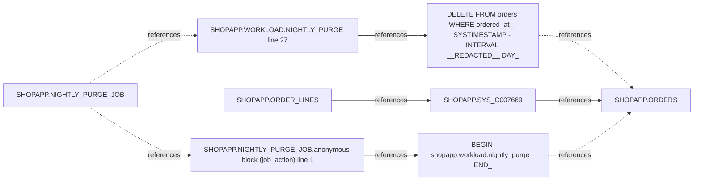

# Issue triage: p1-19c-prod

Read-only evidence. Hypotheses are ranked diagnostic leads, not proof. Source and job literals are redacted; graph call associations and statement ranges are heuristic.

## Issue 1

NIGHTLY_PURGE_JOB

Window: 24h. Codes: ORA-02292, ORA-06512. Reported times: none.

### Ranked hypotheses

1. A child foreign key still references the parent rows being deleted.

- SHOPAPP.SYS_C007669: table SHOPAPP.ORDER_LINES, type R.
- SHOPAPP.WORKLOAD line 27 inside NIGHTLY_PURGE: DELETE FROM orders WHERE ordered_at &lt; SYSTIMESTAMP - INTERVAL '[REDACTED]' DAY;
- SHOPAPP.NIGHTLY_PURGE_JOB line 1 inside anonymous block (job_action): BEGIN shopapp.workload.nightly_purge; END;

2. A child table other than ORDER_LINES may still reference old ORDERS rows (unconfirmed).

- Line 26 already deletes from ORDER_LINES before the ORDERS delete at line 27.
- The recorded constraint currently resolves to SHOPAPP.ORDER_LINES; this does not prove another child table.
- Review all visible child foreign keys. ALL_ fallback can hide other owners; request DBA visibility if needed. Concurrent child inserts or differences between the two DELETE predicates also require investigation.

### Frame excerpts

SHOPAPP.WORKLOAD line 27 inside NIGHTLY_PURGE; ok; DBA_SOURCE.

Statement (heuristic): DELETE FROM orders WHERE ordered_at &lt; SYSTIMESTAMP - INTERVAL '[REDACTED]' DAY;

```plsql
19:   PROCEDURE ship_orders IS
20:   BEGIN
21:     UPDATE orders SET status = '[REDACTED]' WHERE status = '[REDACTED]' AND ordered_at < SYSTIMESTAMP - INTERVAL '[REDACTED]' MINUTE;
22:     COMMIT;
23:   END;
24:   PROCEDURE nightly_purge IS
25:   BEGIN
26:     DELETE FROM order_lines WHERE order_id IN (SELECT order_id FROM orders WHERE ordered_at < SYSTIMESTAMP - INTERVAL '[REDACTED]' DAY);
27:     DELETE FROM orders WHERE ordered_at < SYSTIMESTAMP - INTERVAL '[REDACTED]' DAY;
28:     COMMIT;
29:   END;
30: END workload;
```

SHOPAPP.NIGHTLY_PURGE_JOB line 1 inside anonymous block (job_action); ok; DBA_SCHEDULER_JOBS.

Statement (heuristic): BEGIN shopapp.workload.nightly_purge; END;

```plsql
1: BEGIN shopapp.workload.nightly_purge; END;
```

### Evidence

Named scheduler job actions: ok; DBA_SCHEDULER_JOBS

| OWNER | JOB_NAME | JOB_TYPE | JOB_ACTION |
| --- | --- | --- | --- |
| SHOPAPP | NIGHTLY_PURGE_JOB | PLSQL_BLOCK | BEGIN shopapp.workload.nightly_purge; END; |

Scheduler run history in window: ok; DBA_SCHEDULER_JOB_RUN_DETAILS

| OWNER | JOB_NAME | STATUS | ERROR# | ACTUAL_START_DATE | ADDITIONAL_INFO |
| --- | --- | --- | --- | --- | --- |
| SHOPAPP | NIGHTLY_PURGE_JOB | FAILED | 2292 | 2026-11-04T04:30:02.953Z | ORA-02292: integrity constraint (SHOPAPP.SYS_C007669) violated - child record found<br>ORA-06512: at "SHOPAPP.WORKLOAD", line 27<br>ORA-06512: at line 1<br> |

Source around SHOPAPP.WORKLOAD line 27 (from bounded dictionary source): ok; DBA_SOURCE

See the redacted frame excerpt above; source was collected through the bounded dictionary reader.

Compile errors in SHOPAPP: ok; DBA_ERRORS

No rows returned; absence is limited to visible evidence.

Invalid objects in SHOPAPP: ok; DBA_OBJECTS

No rows returned; absence is limited to visible evidence.

Candidate log tables in SHOPAPP (listed only): ok; ALL_TABLES; DBA_TABLES ORA-00942

No rows returned; absence is limited to visible evidence.

Constraint SHOPAPP.SYS_C007669: ok; ALL_CONSTRAINTS; DBA_CONSTRAINTS ORA-00942

| OWNER | CONSTRAINT_NAME | CONSTRAINT_TYPE | TABLE_NAME | R_OWNER | R_CONSTRAINT_NAME | DELETE_RULE | STATUS |
| --- | --- | --- | --- | --- | --- | --- | --- |
| SHOPAPP | SYS_C007669 | R | ORDER_LINES | SHOPAPP | SYS_C007661 | NO ACTION | ENABLED |

Columns for SHOPAPP.SYS_C007669: ok; ALL_CONS_COLUMNS; DBA_CONS_COLUMNS ORA-00942

| OWNER | CONSTRAINT_NAME | TABLE_NAME | COLUMN_NAME | POSITION |
| --- | --- | --- | --- | --- |
| SHOPAPP | SYS_C007669 | ORDER_LINES | ORDER_ID | 1 |

Parent/key table for SHOPAPP.SYS_C007669: ok; ALL_CONSTRAINTS; DBA_CONSTRAINTS ORA-00942

| OWNER | CONSTRAINT_NAME | TABLE_NAME | CONSTRAINT_TYPE |
| --- | --- | --- | --- |
| SHOPAPP | SYS_C007661 | ORDERS | P |

Columns for SHOPAPP.SYS_C007661: ok; ALL_CONS_COLUMNS; DBA_CONS_COLUMNS ORA-00942

| OWNER | CONSTRAINT_NAME | TABLE_NAME | COLUMN_NAME | POSITION |
| --- | --- | --- | --- | --- |
| SHOPAPP | SYS_C007661 | ORDERS | ORDER_ID | 1 |

All visible child foreign keys referencing SHOPAPP.SYS_C007661: ok; ALL_CONSTRAINTS; DBA_CONSTRAINTS ORA-00942

| OWNER | CONSTRAINT_NAME | TABLE_NAME | R_OWNER | R_CONSTRAINT_NAME | DELETE_RULE | STATUS |
| --- | --- | --- | --- | --- | --- | --- |
| SHOPAPP | SYS_C007669 | ORDER_LINES | SHOPAPP | SYS_C007661 | NO ACTION | ENABLED |

### Local error guide

ORA-02292: Integrity constraint violated: child record found. Typical causes: Parent DELETE/UPDATE still has referencing child rows. Read-only checks: Resolve all child foreign keys, including tables not cleared by the preceding code.

### Numbered debug checklist

1. Named scheduler job actions. Review the rows above and correlate keys and timestamps.

```sql
SELECT OWNER, JOB_NAME, JOB_TYPE, JOB_ACTION FROM DBA_SCHEDULER_JOBS WHERE (JOB_NAME = 'NIGHTLY_PURGE_JOB') ORDER BY OWNER, JOB_NAME
```

2. Scheduler run history in window. Review the rows above and correlate keys and timestamps.

```sql
SELECT OWNER, JOB_NAME, STATUS, ERROR#, ACTUAL_START_DATE, ADDITIONAL_INFO FROM DBA_SCHEDULER_JOB_RUN_DETAILS WHERE ACTUAL_START_DATE >= SYSTIMESTAMP - NUMTODSINTERVAL(24, 'HOUR') AND ((OWNER = 'SHOPAPP' AND JOB_NAME = 'NIGHTLY_PURGE_JOB') OR JOB_NAME = 'NIGHTLY_PURGE_JOB') ORDER BY ACTUAL_START_DATE DESC
```

3. Source around SHOPAPP.WORKLOAD line 27 (from bounded dictionary source). Review the rows above and correlate keys and timestamps.

```sql
SELECT TYPE, LINE, TEXT FROM DBA_SOURCE WHERE OWNER = 'SHOPAPP' AND NAME = 'WORKLOAD' AND LINE BETWEEN 19 AND 35 ORDER BY TYPE, LINE
```

4. Compile errors in SHOPAPP. Review the rows above and correlate keys and timestamps.

```sql
SELECT OWNER, NAME, TYPE, LINE, POSITION, TEXT FROM DBA_ERRORS WHERE OWNER = 'SHOPAPP' ORDER BY NAME, TYPE, SEQUENCE
```

5. Invalid objects in SHOPAPP. Review the rows above and correlate keys and timestamps.

```sql
SELECT OWNER, OBJECT_NAME, OBJECT_TYPE, STATUS, LAST_DDL_TIME FROM DBA_OBJECTS WHERE OWNER = 'SHOPAPP' AND STATUS = 'INVALID' ORDER BY OBJECT_NAME, OBJECT_TYPE
```

6. Candidate log tables in SHOPAPP (listed only). Review the rows above and correlate keys and timestamps.

```sql
SELECT OWNER, TABLE_NAME FROM ALL_TABLES WHERE OWNER = 'SHOPAPP' AND (TABLE_NAME LIKE '%LOG%' OR TABLE_NAME LIKE '%ERROR%') ORDER BY TABLE_NAME
```

7. Constraint SHOPAPP.SYS_C007669. Review the rows above and correlate keys and timestamps.

```sql
SELECT OWNER, CONSTRAINT_NAME, CONSTRAINT_TYPE, TABLE_NAME, R_OWNER, R_CONSTRAINT_NAME, DELETE_RULE, STATUS FROM ALL_CONSTRAINTS WHERE OWNER = 'SHOPAPP' AND CONSTRAINT_NAME = 'SYS_C007669'
```

8. Columns for SHOPAPP.SYS_C007669. Review the rows above and correlate keys and timestamps.

```sql
SELECT OWNER, CONSTRAINT_NAME, TABLE_NAME, COLUMN_NAME, POSITION FROM ALL_CONS_COLUMNS WHERE OWNER = 'SHOPAPP' AND CONSTRAINT_NAME = 'SYS_C007669' ORDER BY POSITION
```

9. Parent/key table for SHOPAPP.SYS_C007669. Review the rows above and correlate keys and timestamps.

```sql
SELECT OWNER, CONSTRAINT_NAME, TABLE_NAME, CONSTRAINT_TYPE FROM ALL_CONSTRAINTS WHERE OWNER = 'SHOPAPP' AND CONSTRAINT_NAME = 'SYS_C007661'
```

10. Columns for SHOPAPP.SYS_C007661. Review the rows above and correlate keys and timestamps.

```sql
SELECT OWNER, CONSTRAINT_NAME, TABLE_NAME, COLUMN_NAME, POSITION FROM ALL_CONS_COLUMNS WHERE OWNER = 'SHOPAPP' AND CONSTRAINT_NAME = 'SYS_C007661' ORDER BY POSITION
```

11. All visible child foreign keys referencing SHOPAPP.SYS_C007661. Review the rows above and correlate keys and timestamps.

```sql
SELECT OWNER, CONSTRAINT_NAME, TABLE_NAME, R_OWNER, R_CONSTRAINT_NAME, DELETE_RULE, STATUS FROM ALL_CONSTRAINTS WHERE CONSTRAINT_TYPE = 'R' AND R_OWNER = 'SHOPAPP' AND R_CONSTRAINT_NAME = 'SYS_C007661' ORDER BY OWNER, CONSTRAINT_NAME
```

### Trace diagram



